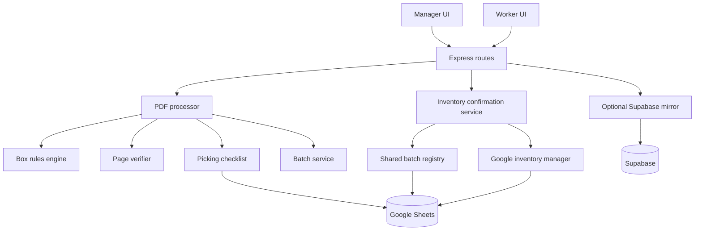

# System Architecture

## Design goals

The application is designed around four operational priorities:

1. Never lose or duplicate an order page.
2. Never mutate inventory before explicit review.
3. Never deduct the same packing work twice.
4. Preserve enough evidence to reconstruct and audit every run.

## Component map



## Module responsibilities

| Module | Responsibility |
| --- | --- |
| `pdfProcessor.js` | Extraction, order pairing, physical quantities, grouping, output PDFs, verification, and ZIP generation |
| `boxEngine.js` | Product-type classification and exact physical box selection |
| `batchService.js` | Stable batch identity and run-manifest persistence |
| `buildInventoryUsage.js` | Canonical product names and batch-specific supply usage |
| `dailyInventoryUpdate.js` | Batch review, confirmation sequencing, and duplicate safeguards |
| `googleInventoryManager.js` | Inventory reads, locks, history, receipts, corrections, and reversals |
| `googleBatchRegistry.js` | Shared cross-computer reservation and confirmation records |
| `pickingChecklist.js` | Google Sheets worker checklist updates |
| `googleWorkerTracker.js` | Shared worker activity records |
| `supabaseOperationsMirror.js` | Optional idempotent record mirroring |
| `server.js` | HTTP boundaries, input validation, and service orchestration |

## Packing transaction sequence

```mermaid
sequenceDiagram
    participant M as Manager
    participant A as Application
    participant P as PDF Pipeline
    participant G as Google Sheets

    M->>A: Upload one or more PDFs
    A->>P: Parse and classify orders
    P->>P: Generate grouped PDFs
    P->>P: Verify pages and pairings
    alt Verification fails
        P-->>A: Error; no successful batch
        A-->>M: Clear failure message
    else Verification succeeds
        P->>G: Update picking checklist
        P-->>A: Save complete batch manifests
        A-->>M: Show inventory review
        M->>A: Explicit confirmation
        A->>G: Reserve shared batch/order keys
        A->>G: Acquire shared inventory lock
        A->>G: Update quantities and append history
        A->>G: Finalize batch confirmation
        A-->>M: Confirm success
    end
```

## Stable batch identity

A batch ID is a SHA-256 digest of canonicalized order data, including:

- order ID;
- tracking number;
- exact worker packing result;
- inventory packing estimate;
- parsed products and physical quantities.

Temporary upload names and upload ordering do not affect identity. A meaningful rule or inventory-estimate change does affect identity, which prevents audit data from being silently reused after packing logic changes.

## Inventory transaction guarantees

All shared mutations follow the same pattern:

1. Validate the request and manager identity.
2. Acquire a shared lock in Google Sheets.
3. Re-read authoritative quantities.
4. Validate item names and non-negative results.
5. Update quantities.
6. Append complete history rows.
7. Roll quantities back if history writing fails.
8. Finalize the lock only after the operation is complete.

If the quantity update succeeds but the final shared state cannot be proven, the application does not automatically retry. It reports that manual review is required, preventing a retry from causing a second mutation.

## Duplicate protection

Duplicate protection has two layers:

- The stable batch ID blocks an exact batch from being confirmed twice.
- Shared order keys block the same orders from being silently reused inside another batch.

The corrected-rerun workflow is an explicit exception. It requires manager acknowledgment that previous quantities were restored, preserves the old records as `SUPERSEDED`, and creates a new authorization record before allowing a corrected batch to proceed.

## Inventory undo model

Undo is implemented as an inverse transaction rather than deletion:

- deductions are added back;
- receipts are subtracted;
- the complete source transaction is reversed together;
- negative results are rejected;
- the source transaction remains immutable;
- a new `REVERSAL` transaction is appended;
- reversal IDs prevent a second undo of the same source.

This produces an auditable ledger and avoids rewriting history.

## Storage boundaries

| Data | Location |
| --- | --- |
| Current inventory and shared operations | Google Sheets |
| Batch audit manifests and generated PDFs | Local private run directory |
| Printable worker bundle | Local ZIP containing PDFs only |
| Optional structured-record mirror | Supabase |
| Credentials and environment configuration | Machine-local ignored files |
| Application source and tests | GitHub |

## Deliberate tradeoffs

### Deterministic rules before AI

Box selection, quantity calculations, and inventory arithmetic use ordinary code. Unsupported combinations go to review. This makes warehouse decisions testable and explainable.

### Exact internal data, simplified worker output

The system tracks exact box sizes internally but consolidates related sizes into fewer worker-facing PDFs. Operational precision does not require adding printing complexity.

### Google Sheets as the operational source of truth

Google Sheets fits the warehouse's current workflow and provides shared visibility across computers. Supabase remains an optional mirror so the application can evolve without forcing a high-risk migration during the initial rollout.

### Append-only correction history

Corrections and reversals create new records rather than deleting old ones. This increases auditability and makes mistakes explainable after the fact.
